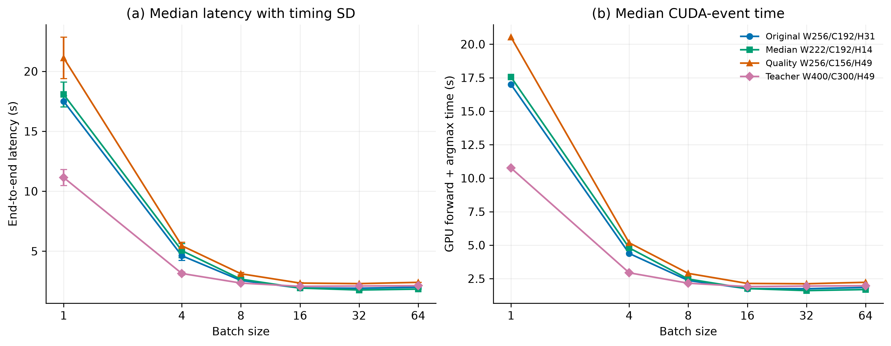

# Batch 扩展与测试集验证：结果分析

实验编号：`cclue-batch-scaling-v0.3`。实验日期：2026-10-17。

## 1. 实验完成情况

本轮完成 26 个开发集条件和 10 个测试集条件，每个条件预热一次、正式测量五次，共 180 次正式测量。开发集用于选择 batch，选择记录在本轮测试前锁定；测试结果未用于重新调整参数。所有条件均可在 RTX 5070 12 GB 上运行，没有显存不足记录，五次预测全部一致。

任务一模型权重保持冻结，上一轮已验收的句长预算结果保留。完整方法、指标及五张图见[实验报告](experiment.md)，开发和测试汇总分别见 [development.csv](development.csv)、[test.csv](test.csv)。

## 2. Batch 扩展的主要结果

batch 从 1 增加到 16，四种固定窗口方案均获得明显加速；继续增加到 32、64 后，耗时逐渐趋于平稳，64 没有成为任何方案的最快条件。以原方案为例，开发集 batch=16、32、64 的中位耗时分别为 1.925、1.910、1.996 秒，峰值已分配显存分别为 0.662、0.751、0.935 GiB。增加显存占用没有带来持续的速度收益。

GPU 前向与 argmax 的中位事件时间分别为 1.747、1.744、1.841 秒，也呈现相同的平台趋势。这说明观察到的耗时平台已经出现在该测量区间内，不能仅归因于窗口拼接等文本处理。CUDA 事件区间不等同于 GPU 利用率，本轮未用 profiler 进一步区分计算、访存与调度成本。

按照事先确定的选择规则，原方案 original256、开发集高分方案 quality256 和 teacher400 均选定 batch=16；句长中位数方案 median222 选定 batch=32。选择优先采用距最快中位耗时不超过 3% 的较小 batch，并限制相对 batch=16 的质量漂移，不以扩大 batch 本身作为目标。

图 1：四种窗口方案在开发集上的耗时与 GPU 事件时间。

## 3. 测试集质量与效率

测试集包含 180 个匿名重建文档组、417,786 字符。下表中输入预算包含两个特殊 token；前缀和后缀长度均为每侧预算，文档首尾不足时使用可用内容。

| 方案 | 输入/核心/每侧上下文 | batch | micro-F1/% | 中位耗时/s | 同窗 batch=1 加速 | 对应串行加速 |
| --- | --- | ---: | ---: | ---: | ---: | ---: |
| original256 | 256/192/31 | 16 | 68.476 | 2.348 | 8.90× | 9.92× |
| median222 | 222/192/14 | 32 | 68.509 | 2.142 | 9.97× | 10.88× |
| quality256 | 256/156/49 | 16 | 68.493 | 2.837 | 8.89× | 8.21× |
| teacher400 | 400/300/49 | 16 | 67.630 | 2.519 | 5.12× | 5.40× |

前面三种方案对应 256-token 串行参考，后者 micro-F1 为 68.633%、中位耗时为 23.291 秒。teacher400 对应 400-token 串行参考，后者为 68.026%、13.589 秒。匹配单窗对照使用与批量方案完全相同的窗口位置和排序，因而“同窗 batch=1 加速”直接反映批量推理的收益；相对串行的差异同时包含窗口设计变化。

median222 是本轮选定方案中耗时最短的条件，吞吐约 195,079 原文字符/秒，峰值已分配显存约 0.726 GiB。相对 256-token 串行参考，总体 micro-F1 低 0.124 个百分点，文档级配对 bootstrap 95% 区间为 [−0.299, +0.020]。该区间包含零，尚不足以确认质量差异，也不构成等效性检验结论。

teacher400 相对对应串行参考加速 5.40 倍，但 micro-F1 低 0.395 个百分点，差值区间为 [−0.567, −0.202]。这组结果体现了固定并行切窗的质量与速度取舍，不能仅根据加速比评价方案。

## 4. 上下文预算在测试集上的表现

以下比较使用本轮已锁定的各方案 batch，与原方案 original256-b16 比较。完整差值及耗时比例见 [window-comparisons.json](window-comparisons.json)。这些比较用于测试结果分析，不参与参数选择。

| 候选方案 | 相对原方案 micro-F1 差值/百分点 | 配对 95% 区间 | 候选耗时/原方案耗时 |
| --- | ---: | --- | ---: |
| median222-b32 | +0.033 | [−0.125, +0.163] | 0.912 |
| quality256-b16 | +0.017 | [−0.202, +0.188] | 1.209 |
| teacher400-b16 | −0.845 | [−1.036, −0.658] | 1.073 |

median222 比原方案中位耗时低约 8.8%，质量点估计相近。quality256 在开发集获得更高分数，但测试集相对原方案仅提高约 0.017 个百分点，区间包含零，中位耗时增加约 20.9%。本轮测试未确认增加到 H=49 的质量优势，开发集上的最高分没有直接转化为稳定的测试集改进。

teacher400 在当前模型上同时表现为质量下降和耗时增加。该方案改变了任务一 256-token 的训练上下文条件；本实验只能说明当前冻结模型、数据和推理实现下的结果，不能据此判断所有模型的最佳输入长度。

综合本轮质量点估计、耗时与资源成本，median222-b32 可作为后续工程完善的优先候选，original256-b16 保留为稳定对照。两者之间的质量差值尚未得到明确统计支持。初版默认配置保持不变，本轮选定参数记录于 [selection.json](selection.json)。

## 5. 数值一致性与实验记录

固定方案在不同 batch 下使用相同窗口，但 BF16 的计算形状变化会导致少量标签差异。例如，原方案 batch=16 与 batch=1 在测试集上有 393 个字符标签不同，约占 0.094%；median222-b32 与自身 batch=1 有 11 个标签不同。每个条件在五轮中的预测均一致。这类差异属于推理数值漂移，不解释为模型训练能力的改善。

全部原始计时、逐类指标、文档长度分组、窗口交界和片段连接附近的质量均保存在 JSON 中。Bootstrap 以匿名文档组为单位进行 2,000 次配对重采样，区间未作多重比较校正。匿名重建长文仍存在原始排版无法恢复的限制。

五张图均提供同名 300 dpi PNG、SVG 和 PDF 文件。详细预测和窗口索引保存于 `code/outputs/task2/cclue-batch-scaling-v0.3/`，运行源码快照保存于 `code/outputs/task2/source-snapshots/cclue-batch-scaling-v0.3/`。工程测试和结果核验记录分别见 [unit-tests-v0.3.json](../unit-tests-v0.3.json) 与 [validation.json](validation.json)。
