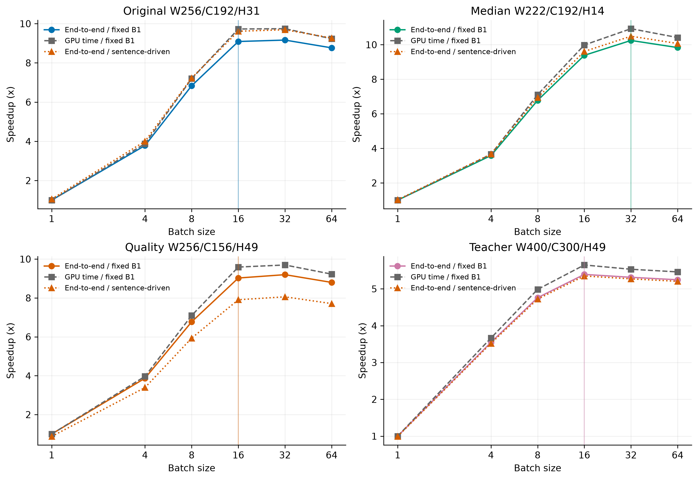
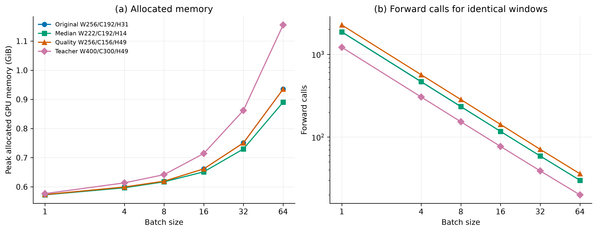
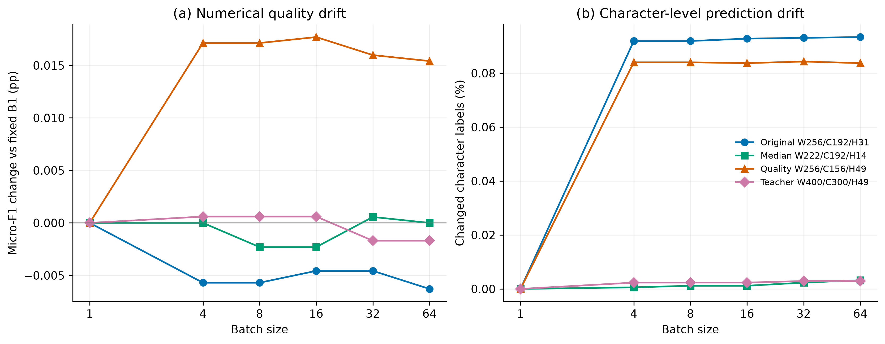
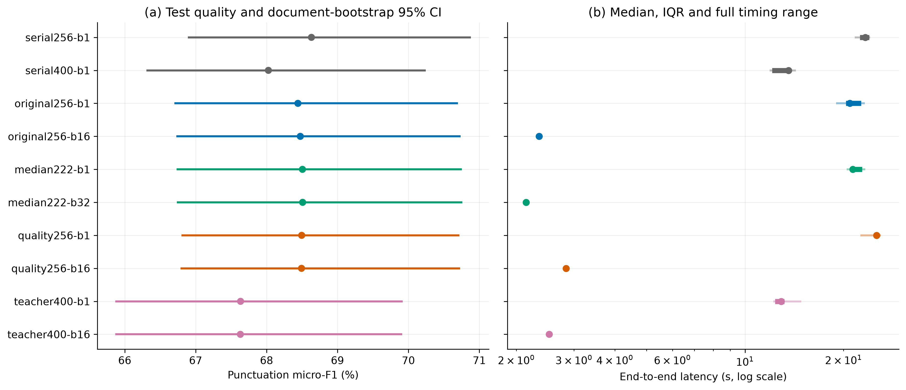

# 任务二：Batch 扩展与测试集验证实验

实验日期：2026-10-17。实验编号：`cclue-batch-scaling-v0.3`。

## 1. 实验目的与前期结论

本实验研究 batch 扩展对长文本断句标点推理的效率、显存与数值一致性的影响，并验证开发集选定参数在测试集上的表现。句长预算实验已完成并验收：少量上下文能够显著改善窗口交界，继续扩大预算的收益有限。本轮沿用任务一冻结的通用中文 BERT，不重新训练模型，也不改写前期结果。

## 2. 实验设置

开发集为 185 个匿名重建文档组、341,563 字符；测试集为 180 组、417,786 字符。

| 窗口方案 | 逻辑输入预算 | 核心预算 | 左右各上下文 | 划分规则 |
| --- | ---: | ---: | ---: | --- |
| original256 | 256 | 192 | 31 | 初版固定窗口，短文可整窗 |
| median222 | 222 | 192 | 14 | 所有长度保持固定核心 |
| quality256 | 256 | 156 | 49 | 初版固定窗口，短文可整窗 |
| teacher400 | 400 | 300 | 49 | 初版固定窗口，短文可整窗 |

开发集每个窗口方案比较 batch=1、4、8、16、32、64，并加入 256/192 与 400/300 两种句号推进串行参考。串行方法每次预测后在推进预算内最后一个预测句号处结束，无句号时按预算前进。前面三种固定方案与串行 256 比较，teacher400 与串行 400 比较；每种固定方案另保留相同窗口的 batch=1，分别衡量窗口设计变化与批量推理的作用。

设备为 NVIDIA GeForce RTX 5070 12 GB，使用 BF16、SDPA 和动态 padding。输入预算包含两个特殊 token；median222 的逻辑输入上限为 222，实际 tensor 补齐至 224。每个条件预热一次，按五轮随机顺序测量。端到端耗时包含编码、构窗、排序、padding、传输、前向、argmax、解码和文本恢复，排除数据/模型加载、文件校验、计分和结果写出；GPU 事件时间单独记录。

每种方案按开发集选择 batch：五次预测一致，micro-F1 与该方案 batch=16 的差值绝对值不超过 0.02 个百分点；在合格条件中选择中位耗时距最快值不超过 3% 的最小 batch。这一规则用于约束数值漂移和控制资源成本，不代表统计等效性。选择及校验值在测试前保存为 selection.json，测试结果不参与参数选择。

## 3. 开发集 Batch 扩展


图 1：开发集端到端中位耗时及计时标准差，以及 GPU 前向与 argmax 的中位事件时间。



图 2：相同固定窗口 batch=1 和句号推进串行方法的加速对照。竖线标出每个窗口方案选定的 batch。

| 窗口方案 | 选定 batch | 开发 micro-F1/% | 中位耗时/s | 原文字符/秒 | 相对相同窗口 batch=1 加速 | 峰值 allocated/GiB |
| --- | ---: | ---: | ---: | ---: | ---: | ---: |
| original256 | 16 | 65.674 | 1.9248 | 177458 | 9.09× | 0.662 |
| median222 | 32 | 65.768 | 1.7638 | 193652 | 10.25× | 0.730 |
| quality256 | 16 | 65.979 | 2.3399 | 145971 | 9.03× | 0.662 |
| teacher400 | 16 | 65.201 | 2.0667 | 165273 | 5.39× | 0.714 |



图 3：峰值已分配显存和 GPU 前向次数。reserved 显存受此前分配器缓存影响，原始值保存在 JSON 中，图中以 allocated 峰值比较资源需求。



图 4：相对同一窗口 batch=1 的 micro-F1 差值和字符标签变化比例。窗口位置不随 batch 改变。

## 4. 测试集质量与速度



图 5：测试集标点质量及文档级 bootstrap 95% 区间，和端到端计时的中位数、四分位区间及完整范围。

| 测试条件 | micro-F1/% | macro-F1/% | 断句 F1/% | 句末边界 F1/% | 中位耗时/s | 原文字符/秒 |
| --- | ---: | ---: | ---: | ---: | ---: | ---: |
| serial256-b1 | 68.633 | 53.791 | 84.143 | 67.896 | 23.2906 | 17938 |
| serial400-b1 | 68.026 | 53.116 | 83.663 | 67.121 | 13.5888 | 30745 |
| original256-b1 | 68.442 | 53.564 | 83.920 | 67.851 | 20.8974 | 19992 |
| original256-b16 | 68.476 | 53.611 | 83.938 | 67.889 | 2.3476 | 177963 |
| median222-b1 | 68.506 | 53.465 | 84.027 | 67.686 | 21.3417 | 19576 |
| median222-b32 | 68.509 | 53.467 | 84.026 | 67.697 | 2.1416 | 195079 |
| quality256-b1 | 68.495 | 53.632 | 84.032 | 67.910 | 25.2245 | 16563 |
| quality256-b16 | 68.493 | 53.653 | 84.022 | 67.865 | 2.8372 | 147251 |
| teacher400-b1 | 67.633 | 52.686 | 83.471 | 66.483 | 12.8932 | 32404 |
| teacher400-b16 | 67.630 | 52.685 | 83.469 | 66.483 | 2.5188 | 165870 |

断句 F1 衡量是否在字符后出现任意一种标点；句末边界 F1 将 。？！ 合并为句末；标点 micro/macro-F1 保留七类标点类型区别，均不包含无标点类别 O。

| 选定测试方案 | 相同窗口 batch=1 加速 | 相对串行加速 | 相对串行 micro-F1 差值/百分点 | 配对 95% 区间 | 与同窗 batch=1 不同标签数 |
| --- | ---: | ---: | ---: | --- | ---: |
| original256-b16 | 8.90× | 9.92× | -0.157 | [-0.308, -0.010] | 393 |
| median222-b32 | 9.97× | 10.88× | -0.124 | [-0.299, +0.020] | 11 |
| quality256-b16 | 8.89× | 8.21× | -0.140 | [-0.334, +0.018] | 350 |
| teacher400-b16 | 5.12× | 5.40× | -0.395 | [-0.567, -0.202] | 7 |

Bootstrap 按匿名文档组进行 2,000 次配对重采样，区间反映文档抽样波动，未作多重比较校正。计时重复使用同一模型与输入，不构成独立模型重复实验。

## 5. 不同长度文档的质量

| 选定测试方案 | ≤512 字符 micro-F1/% | 513～4096 字符 micro-F1/% | >4096 字符 micro-F1/% |
| --- | ---: | ---: | ---: |
| original256-b16 | 69.535 | 68.473 | 68.414 |
| median222-b32 | 69.599 | 68.479 | 68.453 |
| quality256-b16 | 69.711 | 68.402 | 68.449 |
| teacher400-b16 | 69.517 | 67.725 | 67.489 |

长度分组按重建文档正文字符数划分；每组使用该组所有字符的汇总计数计算 F1。文档数量和逐类指标保存在 JSON 中。

## 6. 实验范围与复现

开发集完成 26 个条件，测试集完成 10 个条件。显存不足记录数量分别为 0 和 0。所有条件五次预测一致性：全部一致。任务一冻结文件和已验收的句长预算实验通过运行前后校验。

计时受 GPU 负载、频率及系统调度影响，全部原始测量均保留；接近的耗时应结合波动范围解读。本实验覆盖至 batch=64，不将其视为显存容量上限。长文由匿名片段组重建，无法恢复完整原始排版。测试结果验证当前四种窗口方案，尚未评估两侧不对称上下文、跨窗口概率融合或交界复核。

```bash
cd /home/highsun/code/GuWenBERT-PunctRestore/code/task2
uv sync --locked
uv run --locked --offline pytest -q
uv run --locked --offline python scripts/batch_study.py development
uv run --locked --offline python scripts/batch_study.py test
uv run --locked --offline python analysis/batch_report.py
```

已存在的实验阶段和图表报告拒绝覆盖。重新测量时复制配置并修改 experiment，两个阶段使用同一配置。新的图表报告可用 --experiment 指定实验目录。

开发与测试汇总分别为 [development.csv](development.csv) 和 [test.csv](test.csv)，完整指标及原始计时见 [development.json](development.json)、[test.json](test.json)。测试前的选择记录见 [selection.json](selection.json)。详细预测、窗口索引及运行计划位于 code/outputs/task2/cclue-batch-scaling-v0.3/，运行源码快照位于 code/outputs/task2/source-snapshots/cclue-batch-scaling-v0.3/。五张图均提供 300 dpi PNG、SVG 和 PDF。
