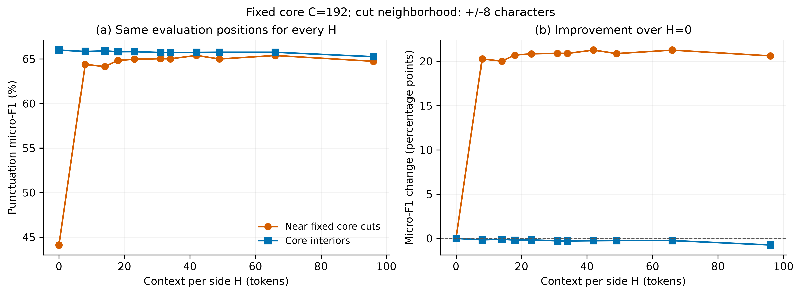
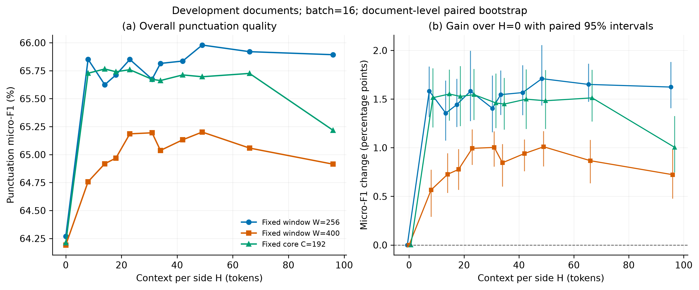

# 句长统计指导上下文预算：结果分析

实验编号：`cclue-context-budget-v0.2`。实验日期：2026-10-17。

## 1. 实验范围

本实验使用任务一冻结的通用中文 BERT，在 CCLUE 开发集重建的 185 个匿名文档组、341,563 个字符上评价上下文预算。模型不重新训练。固定总窗长 256、固定总窗长 400 和固定核心 192 三组实验各包含 11 个预算，共 33 个条件；每个条件预热一次并随机排序测量五次。

训练集共统计 122,601 个完整句末间跨度，句长均值为 18.30 token，中位数为 14，P95 为 42，P99 为 66。由此选取候选长度，并加入零上下文、原配置及较大预算作对照。H 表示前缀和后缀**各自**的最大 token 数；文档首尾不足时使用可用内容。平均句长不能保证任意切点的左右上下文均涵盖完整句子。

完整方法、33 组质量和效率表见[实验报告](experiment.md)，机器可读汇总见 [conditions.csv](conditions.csv)。本轮使用开发集选择参数，与初版在测试集得到的分数分别报告。

## 2. 上下文对窗口交界的影响

固定核心组始终以 192 token 划分核心，所有条件使用相同输出交界，能够在相同字符位置上比较增加上下文的效果。交界左右各 8 字符归入边界区域，共 26,973 字符，其余 314,590 字符归入内部区域。表中 micro-F1 衡量七类标点的恢复质量，不包含无标点类别 O。

| 每侧上下文 H/token | 总体 micro-F1/% | 边界区域 micro-F1/% | 内部区域 micro-F1/% | 中位耗时/s | 耗时标准差/s |
| ---: | ---: | ---: | ---: | ---: | ---: |
| 0 | 64.213 | 44.122 | 66.000 | 2.443 | 0.150 |
| 8 | 65.727 | 64.389 | 65.841 | 2.474 | 1.724 |
| 14 | 65.765 | 64.140 | 65.904 | 2.292 | 0.190 |
| 18 | 65.740 | 64.835 | 65.818 | 2.257 | 0.217 |
| 31 | 65.673 | 65.032 | 65.727 | 2.520 | 1.297 |
| 42 | 65.712 | 65.394 | 65.739 | 3.072 | 0.194 |
| 49 | 65.696 | 64.998 | 65.755 | 3.151 | 1.649 |
| 66 | 65.725 | 65.390 | 65.754 | 3.615 | 1.425 |
| 96 | 65.217 | 64.739 | 65.258 | 4.232 | 0.191 |

图 4：固定核心组的边界与内部区域质量。所有条件使用相同区域划分。

从 H=0 增加到 H=14，总体 micro-F1 提高 1.552 个百分点，文档级配对 bootstrap 95% 区间为 [1.277, 1.802]；边界区域提高 20.018 个百分点，内部区域变化为 −0.097 个百分点。结果表明，少量上下文能够明显缓解窗口截断造成的边界错误，收益集中在输出交界附近。

H=8～66 时，总体 micro-F1 的最高与最低值相差约 0.104 个百分点，继续扩大上下文的收益有限。H=14 的总体分数最高，而边界区域的最高分出现在 H=42，说明局部交界质量与全文质量的最佳预算并不完全一致。H=96 时总体分数下降到 65.217%；更长上下文在本模型和数据上没有带来持续收益。

## 3. 相对原配置的变化

增加上下文相对 H=0 的收益，不能直接等同于相对现有配置的改进。因此进一步比较固定核心组的原预算 H=31、256 总窗长组的 H=31，以及 400 总窗长组的 H=49。下表为其中的代表性对照，完整 18 项比较见 [reference-comparisons.csv](reference-comparisons.csv)。

| 实验组 | 参考 H → 候选 H | micro-F1 差值/百分点 | 配对 bootstrap 95% 区间 |
| --- | --- | ---: | --- |
| 固定核心 192 | 31 → 14 | +0.093 | [−0.151, +0.273] |
| 固定核心 192 | 31 → 18 | +0.068 | [−0.156, +0.260] |
| 固定核心 192 | 31 → 96 | −0.455 | [−0.655, −0.240] |
| 固定总窗长 256 | 31 → 14 | −0.050 | [−0.302, +0.170] |
| 固定总窗长 256 | 31 → 49 | +0.305 | [+0.110, +0.496] |
| 固定总窗长 400 | 49 → 14 | −0.283 | [−0.492, −0.028] |
| 固定总窗长 400 | 49 → 31 | −0.007 | [−0.178, +0.158] |
| 固定总窗长 400 | 49 → 42 | −0.069 | [−0.217, +0.074] |

固定核心组的 H=14 和 H=18 相对 H=31 的差值区间均包含零，目前不足以确认二者优于原预算。固定总窗长 256 时，H=49 的开发集分数为 65.979%，比 H=31 高 0.305 个百分点，但核心由 192 缩短到 156 token，窗口数由 1,863 增加到 2,265，重复正文计算系数由 1.304 增加到 1.594。该差值同时反映上下文长度和核心切点变化。

固定总窗长 400 时，最高开发集分数仍由原配置 H=49 获得，为 65.201%。直接将训练句长中位数 14 或均值近似值 18 作为预算，均未提高该组分数。句长统计适合缩小参数搜索范围，最优预算仍需在具体窗口方案下验证。

图 2：不同上下文预算的总体质量，以及相对各组零上下文基线的变化区间。

## 4. 质量与计算成本

固定核心组的窗口数始终为 1,872，H 从 14 增加到 96 时，重复正文计算系数由约 1.138 增至 1.938，中位耗时由 2.292 秒增至 4.232 秒。固定总窗长组还会因核心缩短而增加窗口数量。例如 256 总窗长下，H=96 需要 5,528 个窗口，中位耗时为 7.281 秒，质量没有超过 H=49。

部分条件的五次计时波动较大，标准差超过 1 秒，全部原始测量均保留。上述耗时用于展示本次运行的成本变化；H=14 与 H=18 等条件之间较小的耗时差不能据此确定稳定的速度排名。质量与吞吐关系见[图 3](figures/03_quality_throughput.png)，窗口数、重复计算、耗时及显存见[图 5](figures/05_resource_cost.png)。

## 5. 结论与适用范围

本轮实验支持用训练句长统计指导上下文候选预算。相比完全没有上下文，左右各增加少量内容能够明显改善交界区域的标点恢复；达到一定长度后，总体质量趋于平稳，继续扩大预算会增加计算成本，也可能降低质量。中位数与均值附近的预算具有实用价值，但不能作为所有窗口设计通用的最优值。

在后续参数选择中，固定核心方案可优先考虑 H=14、18 与原预算 31；固定总窗长 256 可比较 H=31 的效率与 H=49 的质量；固定总窗长 400 可保留 H=49，并将 H=31 纳入较低成本候选。本轮结果作为开发集分析保存，初版默认配置保持不变，最终配置确定后再作一次独立测试集评价。

本实验仅使用一个冻结模型和同一份开发集，重建文档保留了原片段连接，但无法恢复完整原始排版。两侧上下文同步变化，尚未区分前缀与后缀的独立作用。较大预算造成质量下降的具体原因也未通过本实验单独识别。Bootstrap 以匿名文档组为单位进行 2,000 次重采样，区间未作多重比较校正，最高分条件具有开发集选择效应。五次推理的预测完全一致，重复计时不构成五次独立模型实验。

## 6. 图像与结果文件

| 内容 | 文件 |
| --- | --- |
| 训练句长分布及累计分布 | [图 1](figures/01_sentence_lengths.png) |
| 上下文长度与总体质量 | [图 2](figures/02_quality_vs_context.png) |
| 质量与吞吐 | [图 3](figures/03_quality_throughput.png) |
| 相同核心交界的局部质量 | [图 4](figures/04_boundary_effect.png) |
| 耗时、窗口数、重复计算与显存 | [图 5](figures/05_resource_cost.png) |
| 33 条件汇总 | [conditions.csv](conditions.csv) |
| 相对原预算的配对比较 | [reference-comparisons.csv](reference-comparisons.csv) |
| 句长统计 | [training-sentence-statistics.json](training-sentence-statistics.json) |
| 完整指标及原始计时 | [results.json](results.json) |
| 运行与结果校验 | [validation.json](validation.json) |

五张图均提供同名 300 dpi PNG、SVG 和 PDF 文件，后两种格式适合报告中的矢量排版。详细预测和窗口索引保存在 `code/outputs/task2/cclue-context-budget-v0.2/`，本次运行源码快照保存在 `code/outputs/task2/source-snapshots/context-v0.2/`。28 项工程测试通过，全部条件的字符覆盖、指标和抽样区间通过独立复核；任务一冻结文件及初版实验产物保持一致。
