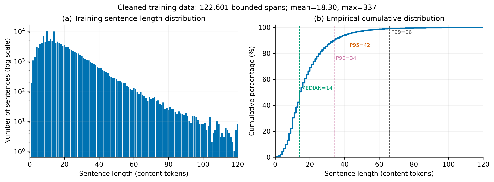
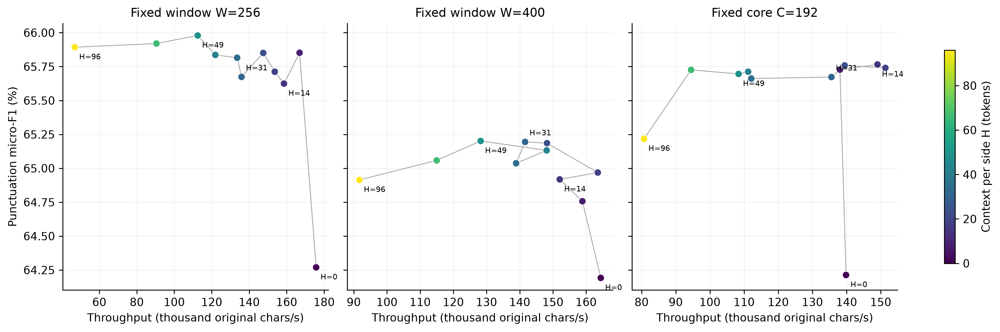
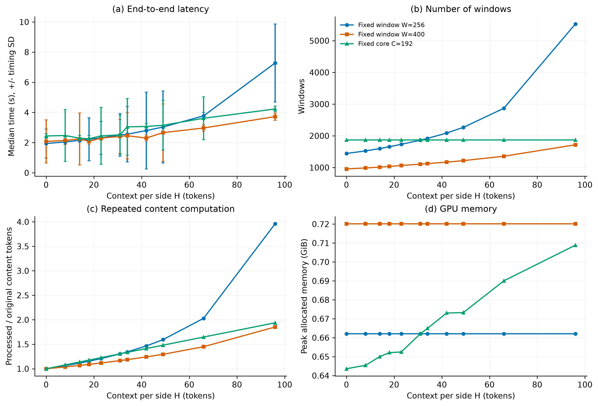

# 任务二：句长统计指导上下文预算的对照实验

实验日期：2026-10-17。实验编号：`cclue-context-budget-v0.2`。

## 实验目的

研究固定窗口推理中，左右上下文长度对古文标点恢复质量及推理成本的影响。模型采用任务一冻结的通用中文 BERT，保持权重、字符编码、解码规则、BF16 精度和 batch size 一致。

## 数据与实验设计

句长统计来自清理后的训练集，以 。？！ 为句末，统计相邻句末间的正文 token 数。连续片段仅在同一匿名文档且原始记录编号连续时连接，各连续区间首个缺少左边界的跨度及末尾不完整跨度排除。共获得 122,601 个句长样本。

| 统计量 | 正文 token 数 |
| --- | ---: |
| 均值 | 18.30 |
| 中位数 | 14 |
| P75 | 23 |
| P90 | 34 |
| P95 | 42 |
| P99 | 66 |
| 最大值 | 337 |



图 1：训练集句长直方图与累计分布。横轴展示至 120 token，完整尾部保存在统计文件中。句长用于提出候选预算，窗口位置不读取句末金标。

评价使用官方开发集重建的 185 个匿名文档组，共 341,563 字符；其中 93 组超过 512 字符，最长 48,582 字符。连接处及来源片段区间保留。测试集不参与本轮参数选择。

候选上下文 H 取训练均值四舍五入、中位数及 P75/P90/P95/P99，另外加入 H=0、8、原配置 31/49 和较大预算 96 作为对照。左右各提供 H token。

| 实验组 | 固定量 | 随 H 改变的量 | 作用 |
| --- | --- | --- | --- |
| 固定总窗长 256 | 总输入预算 256 | 核心预算 C=254−2H，核心边界 | 观察任务一训练长度下的质量与吞吐取舍 |
| 固定总窗长 400 | 总输入预算 400 | 核心预算 C=398−2H，核心边界 | 观察题目示例附近的工程取舍 |
| 固定核心 192 | 核心区间及所有输出交界 | 逻辑窗长 C+2H+2 | 保持相同预测归属位置，直接观察添加上下文的影响 |

固定核心组始终按同一核心预算划分，包括可放入较大输入窗的短文；因此各 H 的核心位置严格一致。逻辑窗口含两个特殊 token，实际 batch tensor 向上补齐至 8 的倍数，且不超过模型上限。固定总窗长组沿用初版短文整窗处理规则。

硬件为 NVIDIA GeForce RTX 5070，batch=16，精度为 bf16。每个条件预热 1 次，再进行 5 个随机顺序测量轮次；计时报告中位数和标准差。

## 总体质量与效果量


图 2：左图为标点 micro-F1；右图为相对各组 H=0 的百分点差值及配对文档 bootstrap 95% 区间。区间基于开发文档组重采样，属于探索性比较，未进行多重比较校正。

| 实验组 | H | 核心预算 | 逻辑窗长 | micro-F1/% | macro-F1/% | 相对 H=0 差值/百分点 | 差值 95% 区间 |
| --- | ---: | ---: | ---: | ---: | ---: | ---: | --- |
| fixed-window-256 | 0 | 254 | 256 | 64.269 | 49.419 | +0.000 | [+0.000, +0.000] |
| fixed-window-256 | 8 | 238 | 256 | 65.852 | 50.415 | +1.583 | [+1.314, +1.835] |
| fixed-window-256 | 14 | 226 | 256 | 65.624 | 50.346 | +1.355 | [+1.072, +1.689] |
| fixed-window-256 | 18 | 218 | 256 | 65.712 | 50.455 | +1.443 | [+1.214, +1.707] |
| fixed-window-256 | 23 | 208 | 256 | 65.850 | 50.536 | +1.581 | [+1.273, +1.996] |
| fixed-window-256 | 31 | 192 | 256 | 65.674 | 50.362 | +1.405 | [+1.158, +1.743] |
| fixed-window-256 | 34 | 186 | 256 | 65.815 | 50.380 | +1.546 | [+1.337, +1.794] |
| fixed-window-256 | 42 | 170 | 256 | 65.836 | 50.454 | +1.567 | [+1.335, +1.847] |
| fixed-window-256 | 49 | 156 | 256 | 65.979 | 50.677 | +1.710 | [+1.433, +2.055] |
| fixed-window-256 | 66 | 122 | 256 | 65.920 | 50.547 | +1.651 | [+1.472, +1.862] |
| fixed-window-256 | 96 | 62 | 256 | 65.893 | 50.510 | +1.624 | [+1.407, +1.880] |
| fixed-window-400 | 0 | 398 | 400 | 64.192 | 48.893 | +0.000 | [+0.000, +0.000] |
| fixed-window-400 | 8 | 382 | 400 | 64.757 | 49.333 | +0.565 | [+0.290, +0.773] |
| fixed-window-400 | 14 | 370 | 400 | 64.918 | 49.693 | +0.726 | [+0.535, +0.941] |
| fixed-window-400 | 18 | 362 | 400 | 64.968 | 50.050 | +0.777 | [+0.567, +0.984] |
| fixed-window-400 | 23 | 352 | 400 | 65.185 | 49.889 | +0.994 | [+0.823, +1.187] |
| fixed-window-400 | 31 | 336 | 400 | 65.195 | 49.784 | +1.003 | [+0.805, +1.168] |
| fixed-window-400 | 34 | 330 | 400 | 65.037 | 50.034 | +0.845 | [+0.601, +1.038] |
| fixed-window-400 | 42 | 314 | 400 | 65.132 | 49.920 | +0.940 | [+0.757, +1.085] |
| fixed-window-400 | 49 | 300 | 400 | 65.201 | 49.988 | +1.010 | [+0.808, +1.171] |
| fixed-window-400 | 66 | 266 | 400 | 65.058 | 49.568 | +0.867 | [+0.634, +1.081] |
| fixed-window-400 | 96 | 206 | 400 | 64.914 | 49.468 | +0.723 | [+0.475, +0.982] |
| fixed-core-192 | 0 | 192 | 194 | 64.213 | 49.585 | +0.000 | [+0.000, +0.000] |
| fixed-core-192 | 8 | 192 | 210 | 65.727 | 50.617 | +1.514 | [+1.207, +1.815] |
| fixed-core-192 | 14 | 192 | 222 | 65.765 | 50.402 | +1.552 | [+1.277, +1.802] |
| fixed-core-192 | 18 | 192 | 230 | 65.740 | 50.386 | +1.527 | [+1.222, +1.839] |
| fixed-core-192 | 23 | 192 | 240 | 65.759 | 50.357 | +1.546 | [+1.285, +1.809] |
| fixed-core-192 | 31 | 192 | 256 | 65.673 | 50.359 | +1.460 | [+1.202, +1.763] |
| fixed-core-192 | 34 | 192 | 262 | 65.662 | 50.404 | +1.449 | [+1.186, +1.718] |
| fixed-core-192 | 42 | 192 | 278 | 65.712 | 50.064 | +1.499 | [+1.193, +1.804] |
| fixed-core-192 | 49 | 192 | 292 | 65.696 | 50.276 | +1.483 | [+1.193, +1.799] |
| fixed-core-192 | 66 | 192 | 326 | 65.725 | 50.475 | +1.512 | [+1.268, +1.801] |
| fixed-core-192 | 96 | 192 | 386 | 65.217 | 49.864 | +1.004 | [+0.746, +1.325] |

各组结果概括：

- `fixed-window-256`：最高 micro-F1 为 65.979%，对应 H=49；各候选间的分数范围为 1.710 个百分点。该条件相对无上下文基线的变化为 +1.710 个百分点。
- `fixed-window-400`：最高 micro-F1 为 65.201%，对应 H=49；各候选间的分数范围为 1.010 个百分点。该条件相对无上下文基线的变化为 +1.010 个百分点。
- `fixed-core-192`：最高 micro-F1 为 65.765%，对应 H=14；各候选间的分数范围为 1.552 个百分点。该条件相对无上下文基线的变化为 +1.552 个百分点。

## 窗口交界与核心内部


图 3：固定核心组各条件使用相同输出交界，交界左右各 8 字符归入边界区域，其余为内部区域。固定核心最佳条件 H=14 相对 H=0，边界区域 micro-F1 变化为 +20.018 个百分点，内部区域变化为 -0.097 个百分点。

固定总窗长组改变核心预算后，实际交界位置也会变化。结果文件另外保存以 C=192 参考核心为基础的统一位置集合指标，供相同位置上的比较。

## 效率与资源成本



图 4：不同上下文预算的质量与原文字符吞吐，颜色表示每侧上下文 H。



图 5：中位耗时及计时标准差、窗口数量、重复正文计算系数和峰值已分配显存。固定核心组的窗口数量保持不变；固定总窗长组在上下文增大时核心变短。

| 实验组 | H | 中位耗时/s | 标准差/s | 字符/秒 | 窗口数 | 重复计算系数 | 峰值 allocated/GiB |
| --- | ---: | ---: | ---: | ---: | ---: | ---: | ---: |
| fixed-window-256 | 0 | 1.9436 | 0.9546 | 175734 | 1443 | 1.000 | 0.662 |
| fixed-window-256 | 8 | 2.0468 | 0.1643 | 166879 | 1524 | 1.063 | 0.662 |
| fixed-window-256 | 14 | 2.1541 | 0.1124 | 158567 | 1597 | 1.116 | 0.662 |
| fixed-window-256 | 18 | 2.2232 | 1.4198 | 153637 | 1656 | 1.155 | 0.662 |
| fixed-window-256 | 23 | 2.3158 | 1.0960 | 147494 | 1732 | 1.208 | 0.662 |
| fixed-window-256 | 31 | 2.5133 | 1.4147 | 135902 | 1863 | 1.304 | 0.662 |
| fixed-window-256 | 34 | 2.5572 | 1.8305 | 133570 | 1919 | 1.344 | 0.662 |
| fixed-window-256 | 42 | 2.8014 | 2.5445 | 121925 | 2087 | 1.466 | 0.662 |
| fixed-window-256 | 49 | 3.0354 | 2.3835 | 112525 | 2265 | 1.594 | 0.662 |
| fixed-window-256 | 66 | 3.7749 | 0.2308 | 90483 | 2868 | 2.030 | 0.662 |
| fixed-window-256 | 96 | 7.2807 | 2.5862 | 46913 | 5528 | 3.960 | 0.662 |
| fixed-window-400 | 0 | 2.0773 | 1.4279 | 164424 | 955 | 1.000 | 0.720 |
| fixed-window-400 | 8 | 2.1498 | 0.2523 | 158883 | 986 | 1.038 | 0.720 |
| fixed-window-400 | 14 | 2.2462 | 1.7224 | 152062 | 1013 | 1.068 | 0.720 |
| fixed-window-400 | 18 | 2.0887 | 0.1852 | 163527 | 1034 | 1.089 | 0.720 |
| fixed-window-400 | 23 | 2.3045 | 0.1438 | 148217 | 1065 | 1.118 | 0.720 |
| fixed-window-400 | 31 | 2.4117 | 1.1351 | 141627 | 1106 | 1.166 | 0.720 |
| fixed-window-400 | 34 | 2.4589 | 1.5359 | 138910 | 1124 | 1.186 | 0.720 |
| fixed-window-400 | 42 | 2.3059 | 0.1945 | 148124 | 1169 | 1.242 | 0.720 |
| fixed-window-400 | 49 | 2.6634 | 1.9073 | 128242 | 1217 | 1.295 | 0.720 |
| fixed-window-400 | 66 | 2.9703 | 0.2098 | 114993 | 1356 | 1.450 | 0.720 |
| fixed-window-400 | 96 | 3.7247 | 0.2371 | 91702 | 1717 | 1.853 | 0.720 |
| fixed-core-192 | 0 | 2.4425 | 0.1496 | 139840 | 1872 | 1.000 | 0.644 |
| fixed-core-192 | 8 | 2.4740 | 1.7245 | 138060 | 1872 | 1.079 | 0.645 |
| fixed-core-192 | 14 | 2.2916 | 0.1904 | 149049 | 1872 | 1.138 | 0.650 |
| fixed-core-192 | 18 | 2.2566 | 0.2168 | 151359 | 1872 | 1.177 | 0.652 |
| fixed-core-192 | 23 | 2.4495 | 1.8928 | 139443 | 1872 | 1.227 | 0.652 |
| fixed-core-192 | 31 | 2.5196 | 1.2969 | 135560 | 1872 | 1.305 | 0.662 |
| fixed-core-192 | 34 | 3.0470 | 1.8837 | 112099 | 1872 | 1.334 | 0.665 |
| fixed-core-192 | 42 | 3.0719 | 0.1939 | 111189 | 1872 | 1.413 | 0.673 |
| fixed-core-192 | 49 | 3.1512 | 1.6494 | 108393 | 1872 | 1.481 | 0.673 |
| fixed-core-192 | 66 | 3.6149 | 1.4248 | 94486 | 1872 | 1.647 | 0.690 |
| fixed-core-192 | 96 | 4.2318 | 0.1913 | 80714 | 1872 | 1.938 | 0.709 |

## 讨论与复现

句长均值和分位数提供了有依据的候选范围，最优上下文还受模型、窗口长度和文本内容影响。固定核心组隔离了核心位置变化，固定总窗长组则体现实际部署中的质量与重复计算取舍。较长上下文可能涵盖更多语义，也会引入其他句子的内容并改变训练时的上下文分布。

本轮使用匿名开发文档重建长文，片段连接后的上下文与原始排版存在差异。bootstrap 描述文档抽样波动，计时标准差描述硬件测量波动；五次重复推理使用相同模型和输入，不视为五次独立质量实验。

全部条件的重复预测一致性：True。模型权重保持冻结，任务一文件通过运行前后校验。

端到端计时覆盖已加载模型下的编码、构窗、排序、padding、传输、前向、解码和文本恢复；不包含数据/模型加载、冻结校验、计分和文件写出。GPU 前向时间、原始重复计时、逐类指标、统一位置指标及文档级 TP/预测数/金标数保存在 `results.json`；汇总表为 `conditions.csv`。

```bash
cd /home/highsun/code/GuWenBERT-PunctRestore/code/task2
uv sync --locked
uv run --locked --offline python scripts/context_study.py run
uv run --locked --offline python scripts/context_study.py plot
```

完整实验已存在时拒绝覆盖。新实验使用新的 experiment；plot 从保存结果重新生成图表及本报告，会覆盖这些生成文件。独立撰写的结果讨论见 [conclusions.md](conclusions.md)。图片提供 300 dpi PNG、SVG 和 PDF 三种格式，英文坐标轴配合本文中文图注可直接用于实验报告。
