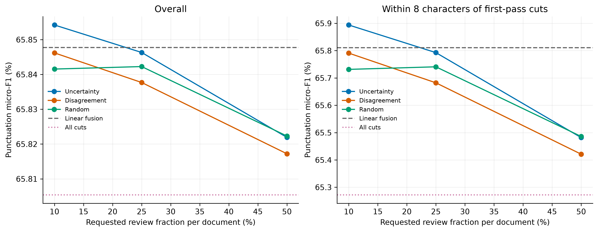
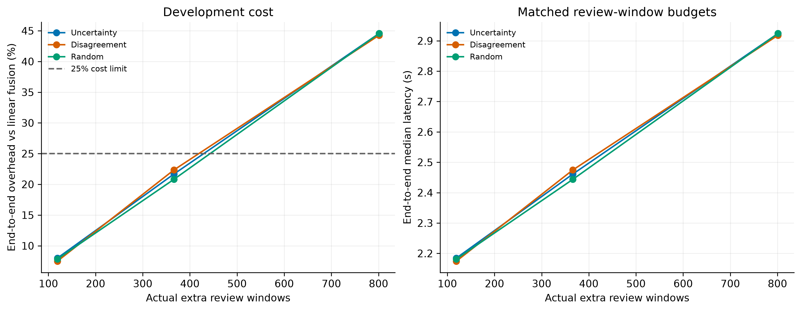
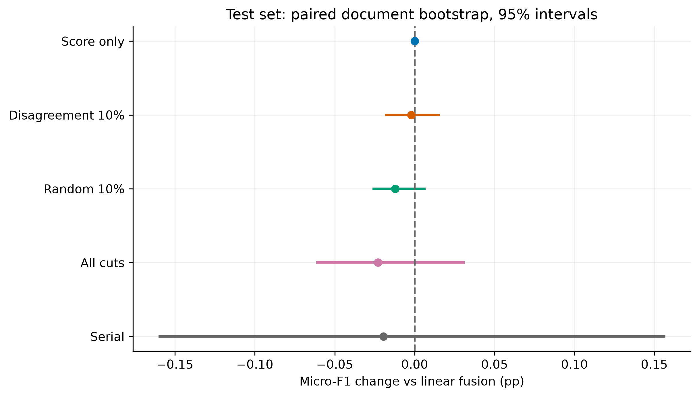
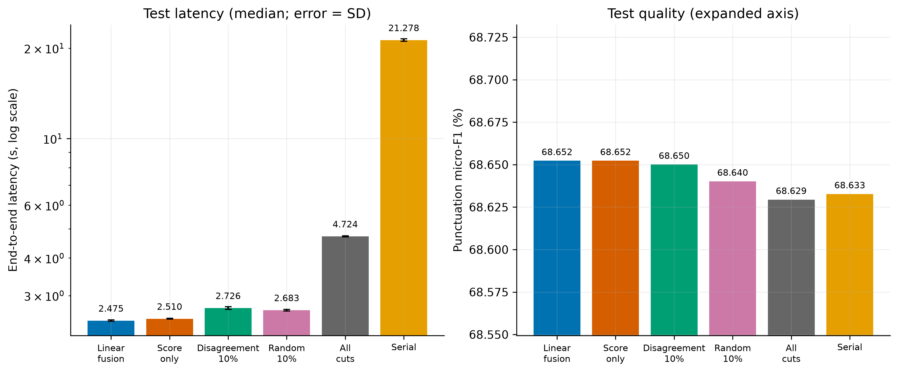
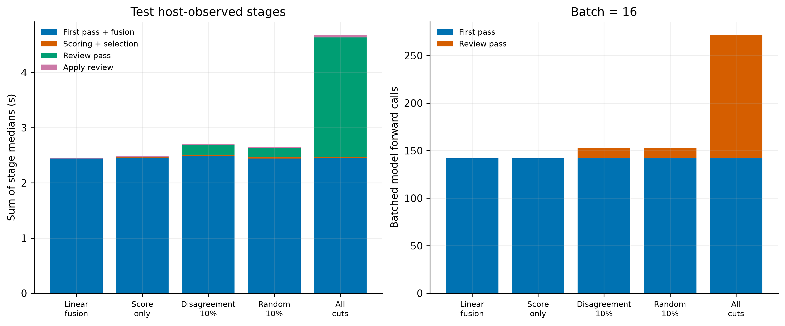
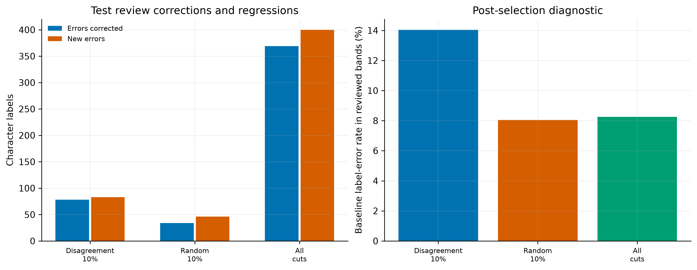

# 任务二：选择性局部复核实验

实验日期：2026-10-17。实验编号：`cclue-selective-review-v0.5`。

## 1. 研究目的

本实验研究在固定窗口并行推理及线性概率融合后，能否通过少量第二遍推理改善窗口交界的标点预测，并将额外耗时控制在 25% 以内。模型沿用任务一冻结的通用中文 BERT，不进行训练。

## 2. 算法与实验设置

第一遍总输入预算为 256 token，核心区 192 token，每侧上下文 31 token，batch=16；保留概率并采用线性中心权重融合。候选位置为第一遍核心区之间的切点。第二遍以切点为中心构建最多 256 token 的输入，仅用其预测替换切点左右各 8 个字符的标签。复核窗口彼此独立，按长度排序后批量推理；未选中的字符保留第一遍预测。字符的全部 subtoken 始终位于同一输入窗口。

不确定性评分为交界局部区间内 1−(最大概率−次大概率) 的均值；分歧评分为该区间内不同覆盖窗口的 argmax 标签不一致的字符比例，分歧相同时优先不确定性较高者。随机对照使用固定种子。每文档分别选择 floor(q×候选数) 个切点，因此实际全局比例通常小于名义预算 q。第二遍区间如重叠，每个字符使用 token 距离最近切点对应的预测，等距时选较早切点。

开发集包含 185 个匿名文档组、341,563 字符，测试集包含 180 组、417,786 字符。开发集比较三种筛选方法及 10%、25%、50% 三个名义预算，并设置线性融合基线、仅评分控制、全量交界复核和串行句号推进，共 13 个条件。每条件预热一次，再以随机顺序正式测量五轮。测试集在开发集锁定选择后运行六个条件，每个条件同样测量五轮。

选择规则为：在重复预测一致、耗时不超过基线 1.25 倍的不确定性或分歧方案中，优先总体标点 micro-F1；与最高分相差不超过 0.02 个百分点时优先低耗时。随机对照和全量复核不参与选择。测试前保存并校验参数、配置与源码指纹。

## 3. 开发集结果



图 1：总体及第一遍交界左右各 8 字符的标点 micro-F1。全量复核是诊断对照，不预设为质量上界。

| 条件 | micro-F1/% | 交界 micro-F1/% | 中位耗时/s | 复核窗口数 | 相对基线耗时 |
| --- | ---: | ---: | ---: | ---: | ---: |
| baseline | 65.8478 | 65.8110 | 2.0228 | 0 | 1.000× |
| score-only | 65.8478 | 65.8110 | 2.0688 | 0 | 1.023× |
| uncertainty-10 | 65.8542 | 65.8938 | 2.1844 | 119 | 1.080× |
| uncertainty-25 | 65.8463 | 65.7927 | 2.4611 | 366 | 1.217× |
| uncertainty-50 | 65.8219 | 65.4817 | 2.9240 | 801 | 1.446× |
| disagreement-10 | 65.8462 | 65.7909 | 2.1743 | 119 | 1.075× |
| disagreement-25 | 65.8377 | 65.6822 | 2.4746 | 366 | 1.223× |
| disagreement-50 | 65.8172 | 65.4210 | 2.9181 | 801 | 1.443× |
| random-10 | 65.8415 | 65.7313 | 2.1811 | 119 | 1.078× |
| random-25 | 65.8423 | 65.7407 | 2.4437 | 366 | 1.208× |
| random-50 | 65.8223 | 65.4858 | 2.9240 | 801 | 1.445× |
| all-review | 65.8054 | 65.2721 | 3.8817 | 1678 | 1.919× |
| serial | 66.2616 | 68.6621 | 17.4038 | 0 | 8.604× |

开发集锁定方案为 **disagreement-10**。成本约束满足情况：满足。



图 2：不同实际复核窗口数量对应的额外耗时与端到端中位耗时。虚线为 25% 额外成本界限。

## 4. 独立测试结果

| 条件 | micro-F1/% | macro-F1/% | 断句 F1/% | 句末 F1/% | 交界 micro-F1/% |
| --- | ---: | ---: | ---: | ---: | ---: |
| baseline | 68.6523 | 53.7265 | 84.0727 | 68.0239 | 68.6900 |
| score-only | 68.6523 | 53.7265 | 84.0727 | 68.0239 | 68.6900 |
| disagreement-10 | 68.6501 | 53.7500 | 84.0771 | 68.0345 | 68.6621 |
| random-10 | 68.6402 | 53.7106 | 84.0656 | 68.0149 | 68.5358 |
| all-review | 68.6294 | 53.7678 | 84.0794 | 68.0320 | 68.4012 |
| serial | 68.6327 | 53.7912 | 84.1434 | 67.8956 | 72.3347 |

断句 F1 将所有标点位置合并；句末 F1 合并 。？！；标点 micro/macro-F1 保留七类标点，不计 O。交界区始终使用第一遍相同切点定义，避免因选区变化改变评价区域。



图 3：相对线性融合的 micro-F1 差值及 2,000 次文档组配对 bootstrap 的 95% 区间。区间未作多重比较校正。

| 比较 | micro-F1 差值/百分点 | 配对 95% 区间 |
| --- | ---: | --- |
| disagreement-10 − baseline | -0.0022 | [-0.0186, +0.0157] |
| random-10 − baseline | -0.0121 | [-0.0264, +0.0068] |
| all-review − baseline | -0.0229 | [-0.0616, +0.0314] |
| serial − baseline | -0.0196 | [-0.1604, +0.1569] |
| disagreement-10 − random-10 | +0.0099 | [-0.0115, +0.0294] |

## 5. 工程成本



图 4：端到端中位耗时与标点 micro-F1。耗时轴使用对数刻度，误差线为五轮计时标准差；质量轴局部放大。

| 条件 | 中位耗时/s | 标准差/s | 相对基线增幅/% | 对串行加速 | 复核窗口/候选 | 复核字符 | 峰值 allocated/GiB |
| --- | ---: | ---: | ---: | ---: | ---: | ---: | ---: |
| baseline | 2.4746 | 0.0137 | +0.00 | 8.60× | 0/2077 | 0 | 0.662 |
| score-only | 2.5101 | 0.0080 | +1.44 | 8.48× | 0/2077 | 0 | 0.662 |
| disagreement-10 | 2.7261 | 0.0288 | +10.16 | 7.81× | 162/2077 | 2592 | 0.662 |
| random-10 | 2.6828 | 0.0165 | +8.42 | 7.93× | 162/2077 | 2585 | 0.662 |
| all-review | 4.7239 | 0.0230 | +90.90 | 4.50× | 2077/2077 | 33216 | 0.662 |
| serial | 21.2782 | 0.1930 | +759.86 | 1.00× | 0/0 | 0 | 0.573 |



图 5：第一遍与融合、评分筛选、第二遍及标签替换的主机计时，以及两遍 batch 前向调用数。各阶段中位数之和不等于端到端耗时中位数；图中阶段不含全部编码、构窗和恢复文本成本。主机阶段时间包含相应 GPU 等待，不能再与 CUDA 事件时间相加。

端到端计时包含编码、构窗、模型前向、概率融合、评分筛选、批量复核、标签替换和文本恢复，排除模型及数据加载、来源校验、质量计分、指纹计算和文件写出。缓存和模型保持预热状态。跨阶段计时受运行时 GPU 状态影响，工程比较以本轮同条件对照为准。

## 6. 复核诊断与采用判定



图 6：复核修正的错误、引入的新错误，以及被选区间的基线标签错误率。以上诊断在选区确定后使用金标准计算，评分筛选过程不读取金标准。

| 条件 | 选区基线错误数 | 复核后错误数 | 修正字符 | 新错误字符 | 改变标签数 |
| --- | ---: | ---: | ---: | ---: | ---: |
| disagreement-10 | 364 | 369 | 78 | 83 | 190 |
| random-10 | 208 | 220 | 34 | 46 | 86 |
| all-review | 2742 | 2773 | 369 | 400 | 885 |

预设采用条件要求相对线性融合的测试 micro-F1 增益区间下界大于零，且耗时增幅不超过 25%。本轮质量条件不满足，成本条件满足，综合判定为**未达到预设采用条件**。详细讨论见 [conclusions.md](conclusions.md)。

## 7. 复现与实验记录

```bash
cd /home/highsun/code/GuWenBERT-PunctRestore/code/task2
uv sync --locked
uv run --locked --offline pytest -q
uv run --locked --offline python scripts/review_study.py development
uv run --locked --offline python scripts/review_study.py test
uv run --locked --offline python analysis/audit_review_study.py
uv run --locked --offline python analysis/review_report.py
```

已完成的阶段和图表拒绝覆盖。重新实验应复制配置、修改 experiment，并为运行及核验脚本传入 --config，为绘图脚本传入 --experiment。先运行开发集，再运行测试集、独立核验和图表生成。

独立核验通过缓存重新计算概率融合、候选评分、每文档预算、随机对照、复核归属和最终标签，重新计算混淆矩阵及配对区间。56 项单元测试通过，任务一和前期实验的保护文件保持一致。指标与计时见 [development.json](development.json)、[test.json](test.json)，参数见 [selection.json](selection.json)，核验见 [validation.json](validation.json)。详细预测与概率缓存在 code/outputs/task2/cclue-selective-review-v0.5/，源码快照在 code/outputs/task2/source-snapshots/cclue-selective-review-v0.5/。六幅图各提供 300 dpi PNG、SVG 与 PDF。

本实验只改变交界的局部观察位置，第二遍窗口仍受 BERT 上下文上限限制；不能解决任意距离的全文指代。匿名长文由原始片段重建，拼接位置保留在数据中，其分布与完整古籍仍有差异。实验使用一个冻结模型，推理重复用于衡量计时和确定性，不代表多次训练。测试数据沿用前几阶段，当前方案虽在开发集锁定后评价，整条研究路线已参考前期测试结果；本轮属于连续探索，最终泛化能力仍需新增外部留出集验证。
