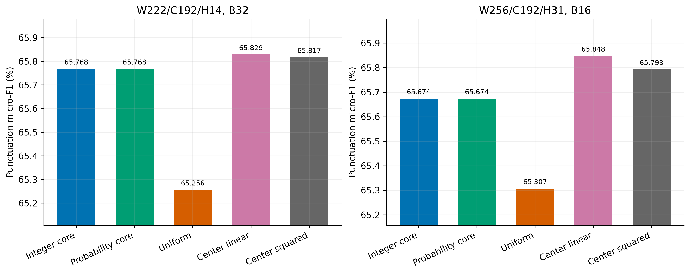
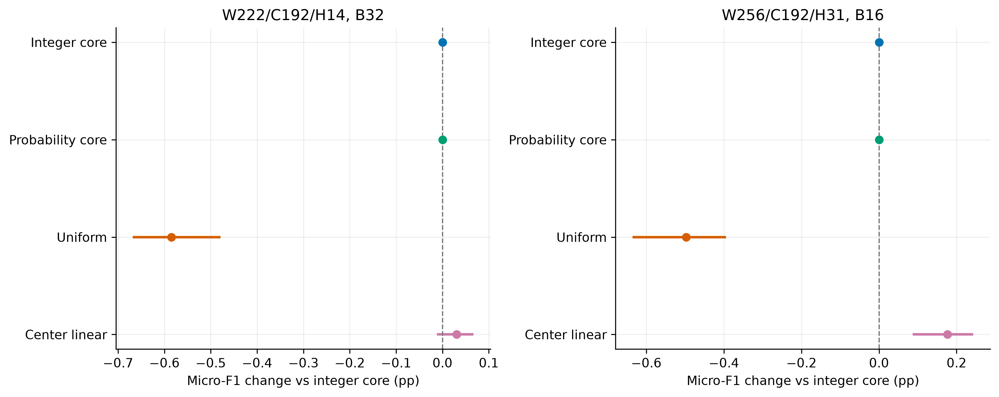
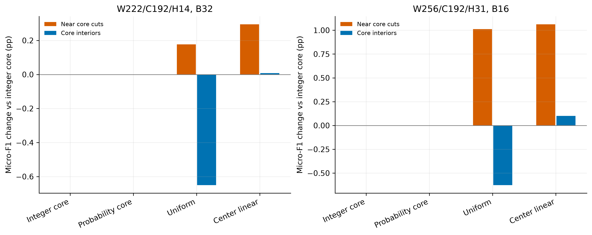
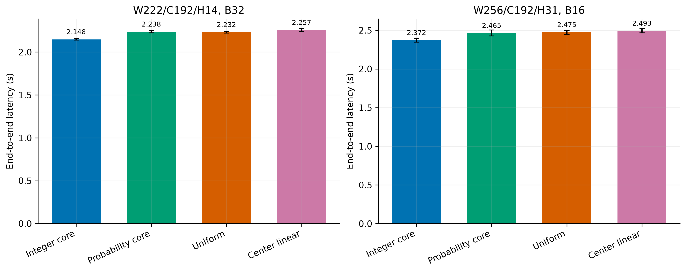
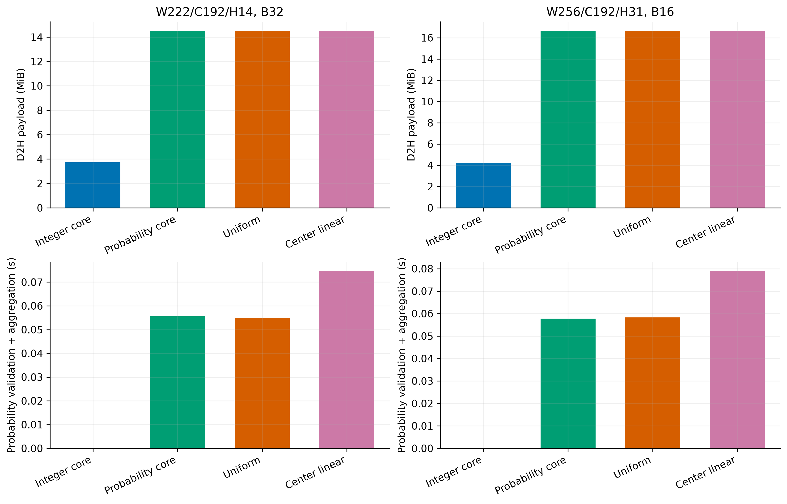
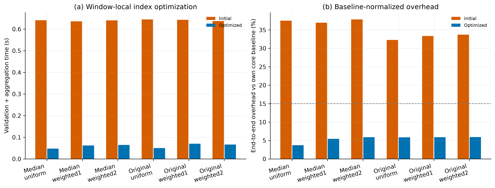

# 任务二：跨窗口概率融合实验

实验日期：2026-10-17。实验编号：`cclue-window-fusion-v0.4-optimized`。

## 1. 目的与实验设计

本实验研究重叠窗口对同一字符的概率融合，能否降低固定并行窗口的交界误差，并评价相对现有整数标签输出的额外成本。使用任务一冻结的通用中文 BERT，不重新训练。

两种窗口方案为 median222（总输入 222、核心 192、每侧上下文 14、batch=32，始终保持核心划分）和 original256（256/192/31、batch=16，短文可整窗）。输入预算含两个特殊 token，median222 的 tensor 补齐至 224。对比保持窗口位置、排序、模型输入、batch 和 BF16 一致。

每种方案包含原整数标签核心输出、保留概率的核心控制、等权融合及中心加权融合。核心概率控制仅使用所属核心窗口的预测，用于分离保留概率的开销。开发集比较线性与平方中心权重；测试集保留各方案选定的权重。串行参考使用 256/192 的句号推进方法。

窗口正文 token 数为 L，字符首个 token 的零基位置为 a、末尾边界为 b，距离 d=min(a,L−b)+1，中心权重 w=(d/ceil(L/2))^α；α=1 为线性，α=2 为平方。融合先计算 Σ(w·p)/Σw，再取 argmax；等权取 w=1。字符对齐采用首个 subtoken，权重距离使用完整字符的 token 边界。softmax 使用 FP32，主机聚合使用 FP64。

开发集共 185 个匿名文档组、341,563 字符；测试集 180 组、417,786 字符。模型和数据均沿用上一阶段。

每条件预热一次，随机排序正式测量五轮。开发集按总体标点 micro-F1 选择加权参数；距最高分不超过 0.02 个百分点时优先较低中位耗时，完全相同则取较小 α。选择记录在测试前锁定，不根据测试分数继续调整。

## 2. 开发集结果与参数选择



图 1：开发集各输出方式的标点 micro-F1。纵轴局部放大以展示细小差异。

| 条件 | micro-F1/% | 边界 micro-F1/% | 中位耗时/s |
| --- | ---: | ---: | ---: |
| median222-core | 65.768 | 64.140 | 1.8110 |
| median222-prob-core | 65.768 | 64.140 | 1.8925 |
| median222-uniform | 65.256 | 64.890 | 1.8785 |
| median222-weighted1 | 65.829 | 64.844 | 1.9098 |
| median222-weighted2 | 65.817 | 64.923 | 1.9178 |
| original256-core | 65.674 | 65.054 | 1.9698 |
| original256-prob-core | 65.674 | 65.054 | 2.0262 |
| original256-uniform | 65.307 | 65.862 | 2.0854 |
| original256-weighted1 | 65.848 | 65.811 | 2.0863 |
| original256-weighted2 | 65.793 | 65.753 | 2.0870 |
| serial256 | 66.262 | 68.662 | 18.1038 |

各窗口选定的中心权重：
- median222：α=1，开发集 micro-F1=65.829%。
- original256：α=1，开发集 micro-F1=65.848%。

## 3. 测试集质量与效果量



图 2：相对同窗整数标签核心输出的 micro-F1 差值和文档级配对 bootstrap 95% 区间。

| 条件 | micro-F1/% | macro-F1/% | 断句 F1/% | 句末 F1/% | 相对核心差值/百分点 | 配对 95% 区间 |
| --- | ---: | ---: | ---: | ---: | ---: | --- |
| median222-core | 68.509 | 53.467 | 84.026 | 67.697 | +0.000 | [+0.000, +0.000] |
| median222-prob-core | 68.509 | 53.467 | 84.026 | 67.697 | +0.000 | [+0.000, +0.000] |
| median222-uniform | 67.924 | 53.194 | 83.525 | 66.673 | -0.585 | [-0.668, -0.479] |
| median222-weighted1 | 68.540 | 53.575 | 84.052 | 67.643 | +0.031 | [-0.012, +0.067] |
| original256-core | 68.476 | 53.611 | 83.938 | 67.889 | +0.000 | [+0.000, +0.000] |
| original256-prob-core | 68.476 | 53.611 | 83.938 | 67.889 | +0.000 | [+0.000, +0.000] |
| original256-uniform | 67.979 | 53.336 | 83.564 | 66.905 | -0.497 | [-0.635, -0.395] |
| original256-weighted1 | 68.652 | 53.726 | 84.073 | 68.024 | +0.176 | [+0.087, +0.243] |
| serial256 | 68.633 | 53.791 | 84.143 | 67.896 | — | — |

断句 F1 合并所有标点位置；句末 F1 合并 。？！；标点 micro/macro-F1 保留七种类型，不包含 O。Bootstrap 以匿名文档组为单位进行 2,000 次配对重采样，未作多重比较校正。



图 3：相同核心交界左右各 8 字符及内部区域相对核心输出的质量变化。每个原文字符只计分一次。

## 4. 效率与资源成本



图 4：测试集端到端中位耗时及五次计时标准差。

| 条件 | 中位耗时/s | 标准差/s | 相对整数核心耗时 | 相对概率控制耗时 | 相对串行加速 | 峰值 allocated/GiB |
| --- | ---: | ---: | ---: | ---: | ---: | ---: |
| median222-core | 2.1483 | 0.0086 | 1.000 | 0.960 | 10.56× | 0.732 |
| median222-prob-core | 2.2376 | 0.0127 | 1.042 | 1.000 | 10.14× | 0.732 |
| median222-uniform | 2.2320 | 0.0106 | 1.039 | 0.997 | 10.17× | 0.732 |
| median222-weighted1 | 2.2571 | 0.0161 | 1.051 | 1.009 | 10.05× | 0.732 |
| original256-core | 2.3716 | 0.0254 | 1.000 | 0.962 | 9.57× | 0.662 |
| original256-prob-core | 2.4651 | 0.0396 | 1.039 | 1.000 | 9.21× | 0.662 |
| original256-uniform | 2.4750 | 0.0272 | 1.044 | 1.004 | 9.17× | 0.662 |
| original256-weighted1 | 2.4933 | 0.0278 | 1.051 | 1.011 | 9.10× | 0.662 |
| serial256 | 22.6927 | 0.3393 | — | — | 1.00× | 0.573 |



图 5：D2H 数据量以及概率校验、加权求和、归一化和 argmax 的主机时间。整数核心方案未单独测量概率聚合，因此该项为零；其完整解码成本包含在端到端耗时中。

端到端计时包含字符编码、构窗、排序、padding、传输、模型、概率计算、聚合、argmax 和文本恢复，排除模型/数据加载、文件校验、质量计分、指纹与缓存写出。所有概率模式保留相同的窗口概率数组，控制保留数组的成本。GPU 前向与概率计算事件分别记录；D2H 等待时间含此前 GPU 工作的同步等待，不与事件时间直接相加。

## 5. 实用性判定

预设工程判定要求：相对整数核心输出，测试总体 micro-F1 增益的配对区间下界大于零，且中位耗时增加不超过 15%。该判定同时考察质量与成本，不以开发集最高分单独决定是否采用。

| 融合条件 | 质量区间下界>0 | 耗时增幅≤15% | 达到预设条件 |
| --- | --- | --- | --- |
| median222-uniform | 否 | 是 | 否 |
| median222-weighted1 | 否 | 是 | 否 |
| original256-uniform | 否 | 是 | 否 |
| original256-weighted1 | 是 | 是 | 是 |

## 6. 核验与复现

所有条件的重复预测、概率指纹和窗口对齐信息保存在原始结果中。核心概率控制须与整数核心输出完全一致；各融合方式须使用相同概率，避免将模型数值变化混入融合效果。独立核验从保存的概率缓存重算加权结果、覆盖次数和权重和，并核对字符级指标及配对区间。

```bash
cd /home/highsun/code/GuWenBERT-PunctRestore/code/task2
uv sync --locked
uv run --locked --offline pytest -q
uv run --locked --offline python scripts/fusion_study.py development
uv run --locked --offline python scripts/fusion_study.py test
uv run --locked --offline python analysis/fusion_report.py
uv run --locked --offline python analysis/audit_fusion_study.py
```

已完成的实验阶段、图表报告及核验记录拒绝覆盖。重新实验须复制配置并修改 experiment，两个阶段均使用 --config 指定；图表脚本以 --experiment 指定新编号。

完整指标与原始计时为 [development.json](development.json)、[test.json](test.json)，汇总表为 [development.csv](development.csv)、[test.csv](test.csv)，参数选择见 [selection.json](selection.json)。详细预测、窗口、概率和聚合缓存位于 code/outputs/task2/cclue-window-fusion-v0.4-optimized/，运行源码快照位于 code/outputs/task2/source-snapshots/cclue-window-fusion-v0.4-optimized/。图像提供 300 dpi PNG、SVG 和 PDF。

本实验只利用重叠窗口已有局部信息，不能恢复单个窗口之外的完整依赖。匿名重建长文保留片段连接位置，但无法恢复完整古籍排版。五次重复推理不视为五次独立模型训练。

## 7. 聚合实现优化

初始开发集测量发现，每窗重复将整个文档的 token 前缀列表转换为数组，等权方案也进行了多余的距离计算。优化后只转换窗口内的索引片段，等权方案直接使用全一权重；公式、模型、窗口和候选参数不变。优化后完整复测开发集，再锁定参数进行本轮测试。

两次开发集的 11 个条件逐一核对，预测和概率指纹完全一致。初始结果及源码快照保留在 cclue-window-fusion-v0.4，比较表见 [implementation-comparison.json](implementation-comparison.json)。两轮计时并非同时进行，因此图中同时展示相对各自整数核心基线的额外耗时。



图 6：开发集聚合实现优化前后的主机耗时和相对各自核心基线的端到端额外成本。虚线表示预设 15% 成本界限。
